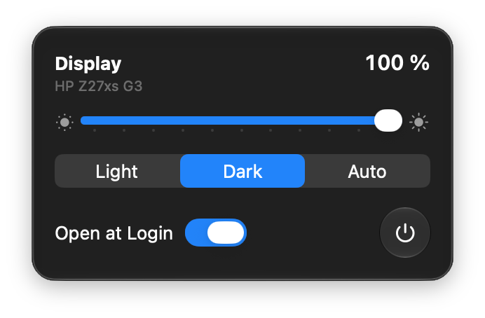

# BrightnessControl

A menu bar slider for an external monitor's brightness on Apple silicon Macs. It sends DDC/CI commands to the monitor over the cable, so it changes the same backlight setting as the buttons on the monitor.



The panel has:

- a brightness slider from 0 to 100 in steps of 10
- Light, Dark and Auto buttons for the macOS appearance
- an Open at Login switch

I wrote it because I wanted one slider for my HP monitor and nothing else.

## Requirements

- macOS 27 or later on an Apple silicon Mac
- An external monitor that accepts DDC/CI. Most do. Some ship with it turned off in the on-screen menu, and DisplayLink adapters don't pass it through.

## Install

Download `BrightnessControl-<version>.zip` from [Releases](../../releases), unzip it and move `BrightnessControl.app` to Applications. Apple notarized the build, so it opens without a Gatekeeper warning.

macOS puts new menu bar icons to the left of the existing ones. Hold ⌘ and drag the sun icon where you want it. macOS remembers the spot.

## How it works

The app keeps running, since a menu bar icon has to belong to a running app. At idle it uses no CPU and about 18 MB of memory. It has no timers and doesn't poll anything.

Moving the slider sends a DDC "set luminance" command, VCP code `0x10`, through `IOAVServiceWriteI2C`. That's a private IOKit function on Apple silicon, the same one [m1ddc](https://github.com/waydabber/m1ddc) calls. You don't need m1ddc installed. A monitor takes tens of milliseconds to process each write, and some lock up when flooded. The app sends only the latest value and waits 100 ms between writes.

Plenty of monitors don't answer DDC reads. My HP Z27xs G3 returns an empty reply. When the read fails, the slider starts at the last value the app sent.

With more than one external monitor, the slider sets all of them to the same value.

The appearance buttons call `SLSSetAppearanceThemeLegacy` and `SLSSetAppearanceThemeSwitchesAutomatically` from SkyLight, the private functions System Settings uses. Scripting System Events would trigger an Automation permission prompt. These calls don't. The buttons follow changes made in System Settings and Auto's switch at sunset.

Both features rest on private APIs, and any macOS update can break them. I test each release on the current macOS 27.

## Build

You need Xcode 27.

```sh
swift build                    # debug build
./scripts/build.sh             # app bundle, signed, notarized, installed to /Applications
NOTARIZE=0 ./scripts/build.sh  # skip notarization
INSTALL=0 ./scripts/build.sh   # leave it in build/
```

`build.sh` signs with the first Developer ID Application identity in your keychain. Set `SIGN_IDENTITY` to pick another. It notarizes with the notarytool keychain profile named in `NOTARY_PROFILE`. Without a Developer ID it signs ad hoc and skips notarization, which is fine for running it on your own Mac.

`./scripts/release.sh` builds a notarized zip and publishes it as a GitHub release for the version in `Resources/Info.plist`.

## License

MIT
